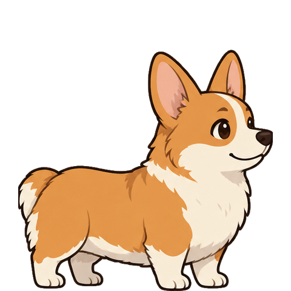

# #2 正式待机实现与证据

2026-10-20。本次从 #13 提交 `bbb7003b69d547683921077696eae397db6ea211` 开始；不沿用旧 #2 分支的通过状态。仅交付本机 macOS Apple Silicon 待机范围。

## 实现

- 主进程启动纯 TypeScript XState actor，当前唯一姿态为 `resting`；系统可见性是独立值，通过共享契约同步，未添加隐藏菜单、互动、拖动、自主活动或公共素材包导入。
- sandbox + contextIsolation 保持开启，Node integration 关闭。单文件 CJS preload 仅暴露 `getPresentation` 请求／响应、`onPresentation` 状态事件和 `reportAssetError` 错误事件；Zod 校验边界消息及素材描述，主进程只接受宠物主 frame 的消息。无任意频道入口。主进程 ESM，renderer ESM。
- 主屏 workArea 底部的 240 × 240 点透明窗口，`floating`、不可取得焦点、`showInactive`、当前待机整体鼠标穿透；这些设置不当作真实跨应用层叠或键盘焦点验收结果。
- `requestSingleInstanceLock` 在创建托盘及窗口之前取得；重复启动退出，不显示／激活已有窗口，不改变可见性意图。菜单栏提供 Quit Mosey。
- electron-log 主进程本地文件日志，单文件阈值 1 MiB，沿用库的单一 `.old.log` 轮转；阈值检查发生在下一次写入之前，文件可超出一个日志条目的大小，不宣称严格字节硬上限。控制台和 IPC 日志关闭，无上传 transport，无逐帧／详细动作日志。记录启动版本、加载与素材错误；实际本机文件为 `~/Library/Logs/Mosey/main.log`。
- 生产只允许 file/data 本地请求；开发额外允许 Forge 本地 origin 与对应 HMR WebSocket。生产图片和描述都随 asar 交付。

## 素材与视觉判断

制作输入保留为 `src/assets/corgi-idle.png`（1254 × 1254）。观察小样时，四张图存在脸部／身体细节变化与低 alpha 杂边；这是本次视觉判断，不是对全部生成素材的概括。没有强行混用这些姿态。

`pnpm assets:build` 用 sharp 提取首张图的 `(56,56,539,506)` 区域，去掉 alpha <128 的杂边，再派生同一身份的轻微呼吸：420 像素宽，394／398／402／398 像素高，固定脚底并居中放入四个 480 × 480 的透明单元。逻辑显示宽 210 点，高 197／199／201／199 点；呼吸总高度变化 4 点，每帧 500ms，总周期 2 秒。没有生成新身份或动作素材。

生成 1920 × 480 图集及版本 1 JSON，记录帧区域、时长、repeat 循环和每帧固定脚底 `(240,480)`。以同一批最终 raster 的 alpha >=128 生成逐行命中区间，命中数据当前仅交付，输入行为由后续票实现。描述仅含图像坐标，不绑定 Canvas API。

renderer 按实际经过时间取帧，只有帧改变时清除并重画；devicePixelRatio 适配显示密度。系统／文档不可见时停止 RAF，恢复时按经过时间重新选帧，不积压播放旧帧。

已查看本次打包截图：为同一只橙白柯基，耳朵／鼻子／尾巴完整，未见裁边或背景矩形，脚底在窗口底边。截图是透明 PNG；静态截图不能单独证明循环自然或桌面合成结果，真实尺寸桌面判断单独记录。

## 本次自动化证据

实际环境：macOS 27.0.1（26A434），arm64；开发 Node 24.18.0，pnpm 12.11.2；运行 Electron 44.9.1 / 内置 Node 24.22.0。`pnpm install --frozen-lockfile` 通过，无锁文件变更。新增精确直接依赖 XState 5.33.3、Zod 4.6.7、electron-log 5.4.4，制作阶段 sharp 0.35.5；锁文件已更新。其余 #13 工具版本保持不变。

采用已确认的真实 Electron 整应用外部行为测试边界：

1. 新增重复启动测试先在 #13 上失败：第二进程 10 秒后仍存活，`exitCode=null`；加入单实例锁后通过。
2. 新增脚底定位测试先失败：不透明脚底在逻辑 y=214，目标为 240；正式图集与锚点绘制后通过。新 renderer 使用 Retina backing store，断言以逻辑坐标观察实际 Canvas 像素。
3. baseline 的 Playwright 导航 load/DOMContentLoaded 等待出现错过事件的超时；改为轮询真实 Canvas 像素判断就绪，避免把导航事件当作用户可见内容就绪。保留真实窗口截图与页面错误检查。

执行结果（17:48，本机时间）：

| 命令                 | 结果                                                      |
| -------------------- | --------------------------------------------------------- |
| `pnpm check`         | strict 类型／lint／格式全部通过                           |
| `pnpm assets:build`  | 正式图集与描述生成通过                                    |
| `pnpm package:mac`   | 生成本地 unsigned darwin-arm64 .app，实际约 288 MiB（du） |
| `pnpm test:dev`      | 1/1，2.48 秒                                              |
| `pnpm test:packaged` | 1/1，2.53 秒                                              |

两种模式均观察到角色不透明像素、截图动画变化、脚底逻辑位置 240、正文无文字、第二次启动进程退出 0 且原进程保留单窗口、renderer 无 require、实际 preload 为 CJS、版本正确及页面无错误。程序调用应用菜单 Quit 回调后，主进程退出码 0。测试保留进程清理和失败截图。菜单回调结果不替代真实鼠标验收，也未通过属性读回宣称桌面层叠／焦点通过。

本次未运行远程 CI；#13 的旧 CI 通过不移作本次通过。没有修改主机网络状态，也没有终止无关应用。

## 新打包程序的真实桌面操作与审查

2026-10-20，主代理通过 CUA 启动并读取本次产物 `out/Mosey-darwin-arm64/Mosey.app`，检查其实际窗口截图：480 × 480 像素，对应 240 × 240 点。静态实际尺寸观察为同一只柯基，轮廓干净，耳朵／鼻子／尾巴完整，脚底抵达窗口底边。此处只记录静态视觉判断；动画变化有前述自动化截图证据，尚未人工完整观察呼吸循环的自然程度与全过程脚底稳定性。

CUA 的 AX 菜单栏仅暴露 **Mosey 应用菜单**。主代理实际用鼠标依次点击该菜单及 **Quit Mosey**，随后 AX 返回 `procNotFound`；用提升权限的 `ps` 匹配本次打包应用的精确路径前缀，未发现该路径下的本应用进程残留。这是新程序的真实鼠标应用菜单退出证据，不是程序调用菜单回调，也不是点击 🐾 托盘菜单的证据。

尝试读取 SystemUIServer 时超时，未获得桌面合成画面；没有把单窗口截图当作跨应用层叠证明，也未取得前台工作应用键盘焦点或断网启动证据。本次未改变主机网络状态。

集成分支双轴审查结果：Standards **0 项**；Spec **1 项 P2**，为尚未完成的真实桌面／断网验收证据缺口。该项仍未解决，不据此新增产品改动；**#2 保持开放，不声明验收完成**。

## 仍须独立桌面证据

以下截至本次证据补充仍无新应用的完整证据，不勾选为通过，不能据此关闭 #2：

- 普通工作窗口上的实际合成层叠、前台工作应用键盘焦点。
- 实际显示尺寸下观察完整呼吸循环与脚底稳定性。
- 真实鼠标选择 🐾 托盘菜单 Quit。应用菜单的真实鼠标退出及该次退出后的精确路径进程清理已完成，范围见上文。
- 已断网状态下启动打包 .app 并继续运行。代码的本地资源限制、启动后断网或模拟请求拦截均不能替代此验收。

其他 macOS 版本、Intel、资源预算、崩溃恢复和完整动作集不在本票已验证范围。
